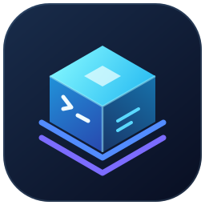

<p align="center">
  
</p>

# VMware Workstation

Local Windows and Linux MCP plugin, version 0.17.4. It implements **all 47 commands in the reference vmrun 1.17.0.25688693 help and all 28 operations in the reference Workstation REST schema**. The bundled MCP server exposes 156 tools: the original 87 tools, six [direct native VNC/RFB console tools](console.md), five [LAN segment tools](#lan-segments), ten [OVF/OVA and background job tools](ovf.md), reusable [job submission](jobs.md), nine [VMDK lifecycle tools](disks.md), six [optional serial tools](serial.md), five [readiness and diagnostics tools](readiness.md), [verified guest execution](guest-exec.md), five [ISO media/boot capability tools](iso.md), three [typed hardware tools](hardware.md), four [declarative VM template tools](templates.md), six [multi-VM lab tools](#multi-vm-labs), two [read-only security inspection tools](security.md), and six [catalog discovery and validated bridge entrypoints](catalog.md). All 150 previous tools remain registered; `get_guest_ip` adds optional bounded-wait fields and updated guidance. Portable templates provide validation, read-only plans, sanitized export and explicit no-overwrite deployment with optional registration/power-on. See [Linux setup and WSL testing](linux.md) for native paths, credentials and validation limits; installed VMware versions/platforms may expose different commands.

Requires VMware Workstation with vmrun, Node.js 22.12+, PowerShell 7 for setup helpers, and a host with local stdio MCP support. REST tools additionally need a running, authenticated vmrest service. Guest OS commands need VMware Tools running and a guest OS account; console tools need neither and work before the OS boots. The plugin runs as your local user and opens no HTTP listener. Native VNC listeners are configured on the VM itself and restricted to localhost.

See [the full command and endpoint reference](reference.md) for the exact operation-to-tool mapping and argument names. `workstation_capabilities` compares the implemented catalog with the locally installed CLI; newer Workstation releases may add operations that require a plugin update. The REST schema was imported from the installed `swagger.zip/json/swagger_WS.json`, SHA-256 `71c8094a4ab765151111ac4fd68a2bf8ace1061d470ef4ac2c5dc6f86aebb3f7`. The installed vmrest reports version 1.3.1 build 25688693.

For missing documented tools, start with [catalog diagnostics and reconnect checks](catalog.md). `a_vmware_catalog` reports the running version and discovers exact operation schemas. Use its `a_vmware_query` or `a_vmware_mutate` route if a direct tool is missing; the original validation and handlers remain in force. Raw MCP and assistant-visible catalogs must be compared separately.

## Connect in Claude

For Claude Code, install the native marketplace plugin:

```powershell
claude plugin marketplace add mdaneri/vmware-workstation-mcp
claude plugin install vmware-workstation@vmware-local
```

Claude Desktop uses the versioned `.mcpb` release asset through **Install Extension** and its managed Node runtime. See [Claude installation and optional settings](claude-installation.md) for prerequisites, updates, removal and catalog diagnostics.

## What you can do

| Area | Implemented capabilities |
| --- | --- |
| Inventory and configuration | Registered/running VMs, selected local hardware details, REST VM settings, restrictions, registration, arbitrary supported config parameters |
| Multi-VM labs | [Coordinate templates, private LANs, dependency/readiness ordering, recovery and tracked-resource teardown](labs.md) |
| VM templates | [List portable Linux/Windows Server/nested ESXi hardware recipes, validate read-only plans, export sanitized hardware and deploy explicitly](templates.md); OS installation is separate |
| Security inspection | [Inspect native backend discovery and selected VM declarations](security.md); encryption/vTPM provisioning remains unsupported |
| Typed hardware | [Inspect capabilities and configure controllers, disks, NICs, CPU topology, nested virtualization, firmware and Secure Boot](hardware.md) |
| Power | Start, soft/hard stop/reset/suspend, pause/unpause, REST power state and operations |
| Snapshots | List flat/tree, create, revert, delete one or delete with children |
| VMDK lifecycle | [Discover disk-manager flags, inspect/create/expand/convert/compact/defragment, and explicit controller/slot attach/detach](disks.md); no guest filesystem resizing |
| ISO media and boot | [Inspect optical drives and boot capabilities, mount/eject existing ISO media with offline backups](iso.md); boot-order writes are unsupported |
| Background jobs | [Submit disk, full offline clone and sequential power operations; monitor, inspect logs and cancel](jobs.md); OVF workflows share the job engine |
| Readiness and diagnostics | [Bounded OS agent/IP/service waits, recent errors and private diagnostic bundles](readiness.md) |
| Guest execution | [Verified program/script execution with captured stdout/stderr and guest exit status](guest-exec.md), plus low-level interactive/active-window/no-wait modes, processes, termination, variables and keystrokes |
| Files and directories | Both transfer directions, existence checks, list/create/delete directories, delete/rename files, create temp files |
| Host integration | Shared-folder add/remove/enable/disable/access changes; device connect/disconnect; screenshots |
| Serial console | [Optional direct named-pipe/UNIX-socket byte I/O](serial.md), explicit offline configuration, bounded reads/writes and per-VM sessions |
| Native console | Direct RFB screenshots, clicks, keys/chords, typing, scrolling and status; independent simultaneous VM sessions |
| VM lifecycle | Full/linked clones, snapshot-based clones, deletion, hardware upgrade, Tools installation/status, Photon VM download |
| Networking | Host networks, network creation, NAT port forwarding, DHCP MAC/IP bindings, VM NIC create/update/delete, guest address and NIC/IP-stack information |

This covers the reference vmrun and Workstation API interfaces. Blank VM creation and [VMDK lifecycle tools](disks.md) use VMware Virtual Disk Manager; optional [OVF Tool support](ovf.md) adds local appliance workflows. Separate management interfaces such as ESXi/vCenter and vmcli mutations are outside this scope; read-only security capability discovery can probe vmcli help/version.

## Security inspection

Use `vm_security_capabilities` to distinguish installed tool discovery from a verified encryption/vTPM backend, and `vm_security_status` with an allowlisted `vmx` path to read selected declarations. Encryption state/mode and actual TPM presence remain unknown without independent native verification. No security mutations or encryption modes are enabled. Read [native feasibility evidence, examples, credentials and recovery limits](security.md); issue #27 remains incomplete.

## Multi-VM labs

Version 0.14.0 adds coordinated lab deployment with `lab_validate`, `lab_deploy`, `lab_status`, `lab_start`, `lab_stop` and `lab_destroy`. See the [complete lab guide](labs.md) for bundled two/three-VM and nested ESXi examples, recovery, teardown checks and validation limits. Native VMware lab deployment and lifecycle validation remain unverified.

For example, plan two blank Linux VMs on a new private LAN, with `app` depending on `database`:

```json
{
  "tool": "lab_validate",
  "arguments": {
    "directory": "C:/VMs/two-vm-lab",
    "lab": {
      "schema_version": "1.0",
      "id": "two-vm-lab",
      "networks": { "backend": { "kind": "private_lan" } },
      "vms": [
        {
          "id": "database",
          "template": "linux",
          "networks": { "primary": "backend" }
        },
        {
          "id": "app",
          "template": "linux",
          "networks": { "primary": "backend" },
          "depends_on": ["database"]
        }
      ]
    }
  }
}
```

The parent directory must exist and the lab directory must be new. On native Linux, use a path such as `/home/alice/vms/two-vm-lab`. Both VM and host-file allowlists apply. Validation checks the dependency graph, template/network/media mappings and aggregate disk space without creating VMs or LAN segments. These are blank hardware recipes: install/configure the guest OS separately, and provide static guest addresses or your own DHCP on the private LAN.

| Step | Tool and arguments |
| --- | --- |
| Deploy after reviewing the plan | `lab_deploy` with the same recipe/directory plus `dry_run: false` and `confirm: true`; `start` defaults to false |
| Inspect ownership and completed/uncertain steps | `lab_status` with `directory`; manifest state does not establish guest readiness |
| Review startup, then start explicitly | `lab_start` with `directory` defaults to dry-run; add `dry_run: false` and `confirm: true` to act |
| Review shutdown, then stop explicitly | `lab_stop` with `directory`, then explicit confirmation; `mode: "soft"` is the default, without hard-stop fallback |
| Review teardown, then destroy explicitly | `lab_destroy` with `directory`, then explicit confirmation; VMs must already be fully powered off, unlocked, unregistered and snapshot-free; disk dependency checks must pass |

Dependencies determine startup order; stopping uses reverse order. Each VM can specify `readiness` with `kind: "none"`, `"boot"`, `"ip"` or `"service"`, `timeout_seconds` (1–600) and `attempts` (1–3). Service checks also require `port` and can specify `protocol`, `path` and `expected_status`. The default `none` in this blank-VM example checks running power and supplies ordering without an OS/service readiness gate. Set appropriate [guest readiness conditions](readiness.md) once the OS and services exist; bounded retries apply to readiness observations.

External network bindings use lab network `kind: "binding"` and the top-level `networks` map; media paths use the top-level `media` map. They remain externally owned. Private LAN changes require all Workstation/Player GUI windows closed, as in the [LAN segment workflow](#lan-segments).

If deployment fails, inspect `lab_status` and the retained manifest before retrying. `lab_deploy` with `resume: true` requires the identical recipe and bindings, skips verified completed VMs and refuses ambiguous partial artifacts. There is no automatic rollback. Destroy checks artifact ownership, external disk references, dependent VMDK chains and shared extents before removing recorded files and owned LAN segments. Unsafe or uncertain resources block teardown; unknown files, member directories and the recovery manifest remain. External VMnets, media and unrelated files are retained.

## Connect in Codex

From the source repository root:

```powershell
codex plugin marketplace add .
codex plugin add vmware-workstation@vmware-local
```

Open a local chat with the plugin enabled and ask: "List my VMware Workstation VMs." Verify the plugin's tools appear before relying on it. The repository build does not install or upload the plugin. Its portable `mcp.json` launches `node ${PLUGIN_ROOT}/server/server.cjs`; runtime npm installation is unnecessary. Follow the host's local plugin install flow for another compatible client.

For manual MCP configuration, replace the example with the extracted absolute path:

```json
{
  "mcpServers": {
    "vmware-workstation": {
      "command": "node",
      "args": ["C:/path/to/vmware-workstation/server/server.cjs"]
    }
  }
}
```

An account upload does not give web/mobile chats access to local VMware processes.

### Update the plugin

Let any plugin background jobs finish, then fully quit the desktop app and close other Codex sessions using this plugin. From an external terminal, refresh the Git marketplace snapshot, install from it, and check the version:

```powershell
codex plugin marketplace upgrade vmware-local
codex plugin add vmware-workstation@vmware-local
codex plugin list --marketplace vmware-local --json
```

`plugin add` alone uses the existing marketplace snapshot and can reinstall an older release. Reopen Codex and start a fresh local chat with the plugin enabled. Call `a_vmware_catalog` with `{"tool":"vmrun_get_guest_ip_address"}` and check version `0.17.4`, `tool_count: 156` and `selected_tool.bridge: "a_vmware_query"`; an old directory remaining in the cache does not prove that version is active. See [catalog diagnostics](catalog.md) if the installed and running versions or exposed tools differ.

For a marketplace registered from a local directory, update that directory and rebuild after source changes before running `plugin add`. `marketplace upgrade` refreshes Git-backed sources only; `codex plugin marketplace list` shows the registered source root.

On Windows, a running Codex session can hold the cached runtime open, causing `failed to back up plugin cache entry: Access is denied`. Close the sessions using the plugin and retry from the external terminal. Do not manually delete the cache or terminate an active plugin job to force an update. See the [official Codex CLI reference](https://developers.openai.com/codex/cli/reference) for these commands.

### Remove the plugin

Let plugin background jobs finish and fully quit Codex sessions using the plugin. From an external terminal:

```powershell
codex plugin remove vmware-workstation@vmware-local
codex plugin list --marketplace vmware-local --json
```

The plugin should be absent from the `installed` list. Removal clears its Codex registration and cache, while VMware Workstation, your VMs and separately stored credentials remain.

If you no longer use the marketplace, optionally remove its registration after removing the plugin:

```powershell
codex plugin marketplace remove vmware-local
```

Reopen Codex after removal. Removing a marketplace registration is separate from uninstalling its plugin.

## Configure credentials locally

On Windows, the plugin automatically reads `%APPDATA%\VMwareWorkstationPlugin\credentials.json`. On Linux, it reads `${XDG_CONFIG_HOME:-$HOME/.config}/vmware-workstation-mcp/credentials.json`. Override either default using an absolute `VMWARE_CREDENTIALS_FILE` path. Credentials never belong in chat/tool arguments. Create or update profiles with PowerShell 7, using the packaged script from this directory:

```powershell
pwsh -NoProfile -File ./scripts/Set-Credentials.ps1 -GuestProfile default
pwsh -NoProfile -File ./scripts/Set-Credentials.ps1 -Rest
pwsh -NoProfile -File ./scripts/Set-Credentials.ps1 -VMPasswordProfile encrypted_lab
```

The script prompts for credentials, preserves other profiles, and restricts file access to your account. The file contains plaintext JSON protected by Windows permissions or Linux ownership and mode 600. See [Linux credential setup](linux.md#credentials-and-guest-operations) for details and the Node-only interactive helper. Its structure is shown below with placeholders only; the script is preferred to manually typing passwords into shell commands:

```json
{
  "rest": { "username": "api-user", "password": "<local password>" },
  "guest": {
    "default": { "username": "guest-user", "password": "<guest password>" },
    "windows_lab": { "username": "Administrator", "password": "<guest password>" }
  },
  "vm": {
    "encrypted_lab": { "password": "<VM encryption password>" }
  }
}
```

Select guest credentials using `guest_profile` (defaults to `default` for guest tools). Select an encrypted VM's password using optional `vm_password_profile`. Profiles can be reused across machines only when their accounts/passwords match. vmrun requires credentials in its process arguments; Windows process-inspection tools running with sufficient access may see them. The plugin redacts loaded credential passwords and Basic auth tokens from its tool output and errors. Guest application output and transferred files can contain other sensitive data and are not generally scrubbed.

Environment variables override file values: `VMWARE_REST_USERNAME`, `VMWARE_REST_PASSWORD`, `VMWARE_GUEST_<PROFILE>_USERNAME`, `VMWARE_GUEST_<PROFILE>_PASSWORD`, and `VMWARE_VM_<PROFILE>_PASSWORD`. Profile names contain letters, digits, and underscores and start with a letter; environment profile names are uppercase.

## Start the Workstation REST service

Configure VMware's own REST account interactively with the installed binary, then start the service in a terminal you control:

```powershell
& 'C:/Program Files/VMware/VMware Workstation/vmrest.exe' -C
& 'C:/Program Files/VMware/VMware Workstation/vmrest.exe' -p 8697
```

Set the same REST username/password in the plugin's local credentials file. The default endpoint is `http://127.0.0.1:8697`. `VMWARE_REST_URL` may specify another HTTP(S) origin, without path/query/credentials. Plain HTTP is accepted only for loopback; remote connections require HTTPS. TLS certificate validation stays enabled; use `NODE_EXTRA_CA_CERTS` when you need to trust a local CA. The plugin neither starts vmrest automatically nor replaces VMware's configured credentials.

REST VM IDs are separate from VMX paths: call `rest_get_all_vms` to obtain IDs, then use those IDs in REST tools. REST `createVM` clones an existing VM, as specified by VMware; it does not install a new guest OS from ISO. VMware controls the clone's destination placement. Some configuration changes require a stopped VM or elevated VMware permissions; the service's response is returned directly.

## Practical guest workflows

For captured stdout/stderr and a verified guest process exit code, use [`guest_exec`](guest-exec.md) with an explicitly selected `guest_profile`, guest OS, command or script interpreter, bounded output and `confirm: true` after authorization. The guide covers runnable Linux/Windows examples, required runtimes, transport versus guest result status, timeout and cleanup behavior. Existing low-level tools below retain their original behavior.

To discover a guest address without credentials, call `get_guest_ip` with its `vmx`. A successful result remains `{ "vmx": "...", "address": "..." }`. On failure it returns an MCP error with code `GUEST_IP_UNAVAILABLE`, the original native error in `message`, `addressAvailable: false`, and a separate `toolsState` observation. The diagnostic calls `checkToolsState` at most once, with up to five seconds within the remaining deadline; if that call fails, times out, or returns an unfamiliar value, its state is `unknown` and its output/error is retained. Target validation failures are returned before either query.

The recognized Tools states are `running`, `installed`, and `unknown`, as documented in the [VMware Workstation vmrun reference](https://techdocs2-prod.adobecqms.net/content/dam/broadcom/techdocs/us/en/pdf/vmware/desktop-hypervisors/workstation/vmware-workstation-pro-17-0.pdf#page=197).

`toolsState.state: "running"` can accompany an IP lookup error saying Tools is not running. These are separate observations: neither the native error nor the later Tools check establishes the underlying cause. Running Tools does not establish IP publication, network reachability, or guest application readiness. Inspect networking and IP publication before considering a service restart or power change. The plugin does not retry the query or replay a mutation automatically.

For a bounded read-only wait during startup, use the convenience native wait option (0.16.0+) with an explicit timeout:

```json
{
  "tool": "get_guest_ip",
  "arguments": {
    "vmx": "C:/VMs/Linux/Linux.vmx",
    "wait": true,
    "timeout_seconds": 60
  }
}
```

Allow a client timeout longer than the requested bound. VMware can return immediately when networking is unavailable, so `wait` does not guarantee recovery. The convenience tool validates the address and keeps its separate Tools cross-check within the same deadline. The existing `vmrun_get_guest_ip_address` accepts the same native wait option and returns native command status/output. A timeout remains a failed observation and does not authorize replaying an earlier power or configuration operation.

After configuring guest credentials, ask: "Run uname on my Linux lab and copy the output to my host." The corresponding tool arguments are shown below. Replace VMX and host paths with your actual paths; create the host transfer directory first.

Run a Linux guest script:

```json
{
  "tool": "vmrun_run_script_in_guest",
  "arguments": {
    "vmx": "C:/VMs/Linux/Linux.vmx",
    "guest_profile": "default",
    "interpreter": "/bin/sh",
    "script": "uname -a > /tmp/system-info.txt 2>&1"
  }
}
```

Copy the resulting file to Windows:

```json
{
  "tool": "vmrun_copy_file_from_guest_to_host",
  "arguments": {
    "vmx": "C:/VMs/Linux/Linux.vmx",
    "guest_path": "/tmp/system-info.txt",
    "host_path": "C:/VM-Transfers/system-info.txt"
  }
}
```

Use `vmrun_copy_file_from_host_to_guest` with `host_path` and `guest_path` to send a local file into the guest. Existing host files are protected unless `overwrite=true`; VMware may overwrite an existing guest destination. For Windows guests, use `vmrun_run_program_in_guest` with `program` such as `C:\Windows\System32\cmd.exe` and `arguments` such as `["/c", "ver > C:\Windows\Temp\version.txt 2>&1"]`, then copy that file back.

The low-level `vmrun_run_program_in_guest` and `vmrun_run_script_in_guest` return vmrun's operation status. They do **not** capture guest stdout/stderr or establish the guest program's exit code. Redirect output in the guest and transfer the resulting file, or use [`guest_exec`](guest-exec.md) for verified results. Use `no_wait`, `interactive`, and `active_window` only when that behavior is needed.

To change VM memory via REST:

```json
{
  "tool": "rest_update_vm",
  "arguments": {
    "id": "<ID from rest_get_all_vms>",
    "parameters": { "processors": 4, "memory": 4096 }
  }
}
```

For a soft CLI shutdown use `vmrun_stop` with the selected `vmx` and `mode: "soft"`. For a full clone use `vmrun_clone` with `vmx`, a new `destination_vmx`, and `clone_type: "full"`. For a linked clone use `clone_type: "linked"` and optionally `snapshot` and `clone_name`.

## Create and modify a VM without a REST service

`create_vm` creates a new VMX and a growable SCSI VMDK in a new directory. It supports a guest OS identifier, RAM, CPUs, disk capacity, virtual hardware version, BIOS/EFI, network type/custom VMnet, and an optional boot ISO. Its parent directory must already exist. It never overwrites an existing directory, registers the VM, boots it, or installs an operating system.

```json
{
  "tool": "create_vm",
  "arguments": {
    "directory": "C:/VMs/new-linux-lab",
    "name": "Linux lab",
    "guest_os": "otherlinux-64",
    "memory_mb": 4096,
    "cpus": 2,
    "disk_gb": 40,
    "firmware": "efi",
    "network": "nat",
    "iso_path": "C:/ISOs/linux-installer.iso"
  }
}
```

Open the returned VMX in Workstation, or call `rest_register_vm` when REST is configured, then start it with `vmrun_start` to install the OS from the selected ISO. VMware guest OS identifiers and compatible virtual hardware versions are passed through; default hardware version 21 is compatible with Workstation 17 and this installed version.

Use `configure_vm` to edit an existing powered-off VM locally. The tool creates a uniquely named VMX backup, preserves comments and other settings, removes duplicate versions of changed keys, and saves the updated file. It rejects running, locked, detected suspended, and non-UTF-8 VMs. VMX values are strings; null removes a setting. Close/reopen the VM's Workstation tab if it cached the previous configuration.

After a plugin update, an existing chat may still be connected to the previous server. If a protected VMX edit reports `PLUGIN_RUNTIME_MISSING`, reconnect the plugin or open a fresh chat to use the installed version; reinstall/reimport if the error persists. The server checks for its Windows file-protection helper before creating a backup. Failed preparation removes incomplete backup/edit files, retains any completed backup, and leaves the original VMX in place. A network-only edit can require protection when the VMX contains a VNC password/key.

```json
{
  "tool": "configure_vm",
  "arguments": {
    "vmx": "C:/VMs/new-linux-lab/machine.vmx",
    "settings": {
      "memsize": "8192",
      "numvcpus": "4",
      "ethernet0.connectionType": "hostonly"
    }
  }
}
```

VMX editing does not resize VMDKs or guest filesystems; use the corresponding VMware workflow for disk expansion. Arbitrary VMX settings still need to form a valid, compatible VMware configuration. The tool detects concurrent writes before replacement, but cannot exclude another VMware process starting at the same time.

## LAN segments

Use LAN segments to connect a group of lab VMs on a private network. These are separate from NAT, host-only, and custom VMnet networks. Workstation does not supply DHCP on a LAN segment; configure static guest addresses or run your own DHCP service in a guest.

Version 0.4.0 adds five tools. Listing is read-only and works with the Workstation GUI open. For any change, close **all Workstation/Player GUI windows** first so cached settings cannot overwrite offline edits. Fully power off a VM before attaching or detaching an adapter; running, locked, and detected suspended VMs are refused. No VMware UI automation or REST service is involved.

For example, connect two existing adapters to a segment called `Lab backend`:

```json
{ "tool": "create_lan_segment", "arguments": { "name": "Lab backend" } }
```

```json
{ "tool": "list_lan_segments", "arguments": { "vmx": "C:/VMs/app/machine.vmx" } }
```

```json
{ "tool": "attach_vm_adapter_to_lan_segment", "arguments": { "vmx": "C:/VMs/app/machine.vmx", "adapter": 1, "segment": "Lab backend" } }
```

```json
{ "tool": "attach_vm_adapter_to_lan_segment", "arguments": { "vmx": "C:/VMs/db/machine.vmx", "adapter": 0, "segment": "Lab backend" } }
```

`adapter` is the **zero-based VMX index**: `0` means `ethernet0` and `1` means `ethernet1`. Use the optional `vmx` on `list_lan_segments` to inspect adapter indices, names and segment IDs; omit it to list just the catalog. The tools preserve other adapters, hardware and MAC settings. Attach clears an obsolete custom VMnet setting and enables connection at next boot. It uses an existing present adapter; add adapters separately through the existing VM configuration workflow. Creating a uniquely named existing segment returns its ID without creating a duplicate. Duplicate names require selection by `id` (the VMware `pvnID`) from the listing.

To detach an adapter while preserving it, choose its replacement network:

```json
{ "tool": "detach_vm_adapter_from_lan_segment", "arguments": { "vmx": "C:/VMs/app/machine.vmx", "adapter": 1, "segment": "Lab backend", "network": "hostonly" } }
```

The adapter is left **disconnected**, including at the next boot (`connected` and `startConnected` are `FALSE`). Replacement modes are `nat` (default), `bridged`, `hostonly`, and `custom`; `custom` requires `vmnet`, for example `"vmnet7"`. Reconnect it explicitly when ready. Detach also cleans a matching segment ID from a disabled adapter without enabling it. If its catalog entry was deleted elsewhere, supply the orphaned `pvnID` directly.

Detach every reference before removing a segment:

```json
{ "tool": "detach_vm_adapter_from_lan_segment", "arguments": { "vmx": "C:/VMs/db/machine.vmx", "adapter": 0, "segment": "Lab backend" } }
```

```json
{ "tool": "remove_lan_segment", "arguments": { "segment": "Lab backend", "vmx_paths": ["C:/VMs/app/machine.vmx", "C:/VMs/db/machine.vmx"] } }
```

Removal always checks registered and running VMs, plus optional `vmx_paths` for unregistered VMs. It refuses remaining IDs, including disabled/disconnected adapters, and unreadable, encrypted, unsupported or out-of-root VM files. Missing stale inventory files are reported and skipped; a missing explicitly supplied VMX is an error. It cannot discover other unregistered VMs or VMs owned by other host users, so supply all relevant unregistered VMX paths. Missing or malformed inventory blocks removal. There is no force removal or automatic mass detach.

The catalog is per host user: `%APPDATA%/VMware/preferences.ini` on Windows or `~/.vmware/preferences` on Linux; `VMWARE_PREFERENCES_PATH` overrides it with an absolute path. Catalog edits support UTF-8 and Windows-1252, preserving unrelated bytes and line endings. Names must fit the existing encoding; other encodings are refused rather than converted. Adapter VMX files must be UTF-8. Changes create adjacent uniquely named backups (initializing missing preferences has no previous file to back up), private catalog replacement files, and a temporary catalog lock. Never remove a lock while an operation is active. Concurrent file changes abort the write; other VMware processes can still race the final replacement, so keep external configuration tools idle during changes.

Automated tests exercise catalog changes and adapter transitions in temporary fixtures, native process guards, and bundled MCP discovery/listing. Real LAN segment mutations and guest connectivity have not been live-validated; the implementation matches the catalog format observed read-only on Workstation 26.0.1.

## Scope and operation behavior

| Variable | Meaning |
| --- | --- |
| `VMRUN_PATH` | Absolute native vmrun path; default discovery checks Program Files/PATH on Windows and standard native locations/PATH on Linux |
| `VMWARE_VDISKMANAGER_PATH` | Optional absolute disk-manager path for blank VM creation and VMDK lifecycle tools; otherwise discovered beside vmrun, on PATH or in standard native locations |
| `VMWARE_OVFTOOL_PATH` | Optional absolute OVF Tool executable path for appliance workflows |
| `VMWARE_INVENTORY_PATH` | Override inventory.vmls location |
| `VMWARE_PREFERENCES_PATH` | Absolute current-user preferences override for the LAN segment catalog |
| `VMWARE_ALLOWED_ROOTS` | Absolute directories for VMX targets and CLI clone/template destinations |
| `VMWARE_ALLOWED_HOST_ROOTS` | Absolute directories for host files, including transfers, screenshots, shared folders, disks and media |
| `VMWARE_CREDENTIALS_FILE` | Optional absolute credentials JSON path |
| `VMWARE_REST_URL` | REST origin; default http://127.0.0.1:8697 |

Separate allowed-root entries with semicolons on Windows and colons on Linux. Pass these environment settings to the MCP server process; a desktop app may not inherit your shell settings.

Without configured roots, explicitly selected accessible paths are generally permitted; [diagnostic bundles](readiness.md) require approved roots. With roots configured, the plugin checks real paths to avoid directory-link escapes; REST VM IDs are resolved to VMX paths before VM operations. Inventory still lists paths outside allowed roots. REST clone destination placement is controlled by VMware. Root checks scope direct path operations; they are not an OS sandbox and do not restrict what an authorized guest program, shared folder, or arbitrary VM configuration can do.

Each low-level tool accepts `timeout_seconds` from 1 to 3600 (default 120); output is limited to 1 MiB. CLI invocations are serialized within this process, and REST workflows are serialized separately. Other VMware processes can act concurrently. A failed/timed-out mutation can have taken effect; inspect state before retrying. Soft shutdown never falls back to hard automatically. Destructive changes require the user's authorization for the exact target and action.

Inventory combines Workstation's inventory file and `vmrun list`, not a disk scan. A non-running VM may be powered off, suspended, or unavailable. Power-command success does not prove service readiness. The convenience snapshot revert/delete tools reject duplicate snapshot names; low-level CLI tools retain VMware's snapshot naming/path semantics, so inspect the tree to choose the exact target.

## OVF/OVA appliances

Use `ovf_tool_status` to discover optional VMware OVF Tool, or set the absolute `VMWARE_OVFTOOL_PATH` environment override. `ovf_inspect`, `ovf_validate`, `ovf_import`, `ovf_export` and `ovf_convert` return background job IDs; poll `job_status`, inspect `job_logs`, or request `job_cancel`. Imports default to unregistered and powered off. OVF/VMX outputs require new directories; only one OVA file permits explicit overwrite. See the [appliance workflow guide](ovf.md) for Windows/Linux path configuration, runnable argument examples, private deployment-property profiles, limitations and live validation.

## Typed hardware

Read the [typed hardware guide](hardware.md) for declarative multi-controller/disk/NIC nested ESXi labs, CPU topology, nested virtualization, firmware and Secure Boot. Start with `vm_hardware_capabilities` and `vm_hardware_get`; apply authorized backed-up offline changes with `vm_hardware_set`. Existing creation defaults remain compatible. Unsupported versions and vTPM/encryption changes fail explicitly.
